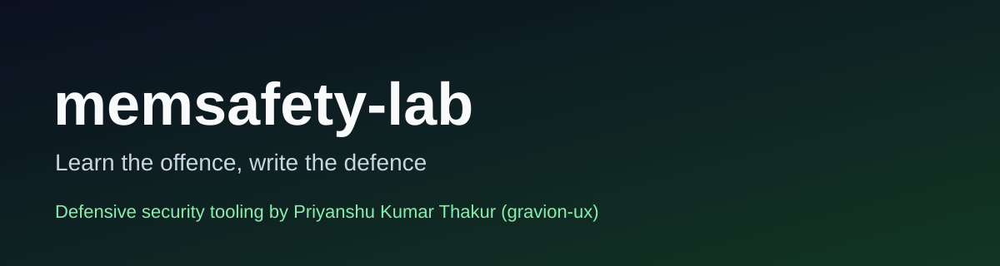

# memsafety-lab

Educational memory-safety lab toolkit: scans C source for the unsafe
functions behind classic buffer overflows (`gets`, `strcpy`, `sprintf`,
unbounded `scanf`...) and prints the safe replacement for each hit as a
fix checklist.

Built from Red Team Leaders coursework, C++ Practitioner Professional
(CCPP): you learn the offence to write the defence. Defensive and
educational only — it analyses code you own and ships no exploit material.

## Install

```bash
pip install -e .
```

Requires Python 3.11+.

## Usage

```bash
memsafety-lab src/*.c
memsafety-lab main.c --format json
```

## Tests

```bash
pytest
```

## License

MIT
